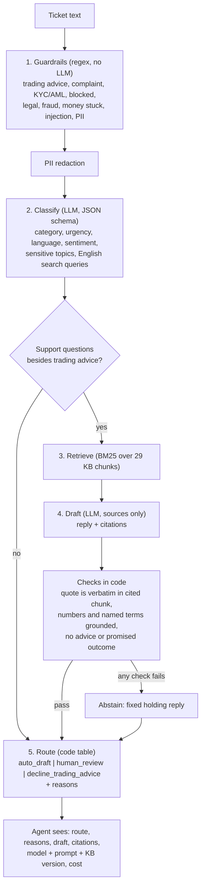

# Support-ticket co-pilot for a forex/CFD broker

A co-pilot for support agents. For every incoming ticket it:

1. **classifies** it: category, urgency, language, sentiment;
2. **drafts a reply grounded in the public help centre**, with a verbatim quote and link for
   every fact, or **abstains** when the help centre does not cover the question;
3. **routes** it: `auto_draft` (agent can send after a glance), `human_review`, or
   `decline_trading_advice`.

Nothing is sent to customers automatically. The knowledge base is four public Valetax help
pages (deposit, withdraw, open an account, verify account), used as they are.

Contents: [Quickstart](#quickstart) · [How a ticket flows](#how-a-ticket-flows) ·
[Hard rules](#hard-rules-and-how-each-is-enforced) · [Results](#eval-results) ·
[Phase 1 vs Phase 2](#phase-1-vs-phase-2) · [Limitations](#limitations-and-what-the-real-version-would-do) ·
docs: [business case](docs/business-case.md), [decisions](docs/decisions.md),
[phase 2](docs/phase-2.md), [KB audit](docs/kb-audit.md)

## Quickstart

Requires Python 3.12+ and [uv](https://docs.astral.sh/uv/).

```bash
uv sync

# Offline, no API key: deterministic fake model
uv run copilot triage --provider fake "What is the minimum deposit amount?"

# Real model: put OPENAI_API_KEY=... in .env (git-ignored)
uv run copilot triage "Сколько времени занимает зачисление депозита?"
uv run copilot triage --file eval/tickets.jsonl          # one {id, text} per line
uv run copilot triage --json "My withdrawal was rejected, why?"   # full result incl. audit fields

# Checks (all offline)
uv run pytest && uv run ruff check . && uv run mypy

# Eval against the real model (~$0.20 for 51 tickets with gpt-4.1)
uv run python -m eval.run                 # writes eval/report.md, results.jsonl, summary.json
uv run python -m eval.compare             # table of all runs
uv run python -m copilot.kb_extract       # rebuild kb/*.md from kb/raw/*.html
```

Example output:

```text
Ticket adhoc: Сколько времени занимает зачисление депозита?
Classification : category=deposit urgency=low language=ru sentiment=neutral
Guardrails     : none
ROUTE          : auto_draft  (grounded_answer_all_checks_passed)
Draft reply    :
   Зачисление депозита происходит мгновенно — обновленный баланс будет
   доступен в течение 60 минут.
Citations      :
   - https://valetax.com/how-to-deposit/ [How long does it take for deposited funds to be
     credited to my balance?] "Deposits are instant! You will be able to view your updated
     account balance within 60 minutes."
Cost/latency   : $0.00438, 1765+106 tokens, 2293 ms, model=gpt-4.1
```

(The reply faithfully repeats a contradiction in the source page: "instant" and "within 60
minutes". See the [KB audit](docs/kb-audit.md).)

## How a ticket flows



| Step | Code | LLM? |
|---|---|---|
| 1. Guardrails, PII redaction | `copilot/guardrails.py` | no |
| 2. Classification | `copilot/pipeline.py`, prompt in `copilot/prompts.py` | yes, structured output |
| 3. Retrieval | `copilot/retrieval.py`, chunks from `copilot/kb.py` | no |
| 4. Draft + checks | `copilot/draft.py` | draft yes, checks no |
| 5. Routing | `copilot/routing.py` | no |
| Fixed texts (decline, holding reply; 6 languages) | `copilot/templates.py` | no |
| LLM layer (OpenAI + offline fake, retries, timeout, cost) | `copilot/llm.py` | — |

Every result also carries the audit fields a regulated business needs: SHA-256 of the input,
model, prompt version, KB version (content hash), retrieved chunk ids, tokens, cost, latency.

## Hard rules and how each is enforced

| Rule | Enforced in code (deterministic) | Enforced by the LLM (best effort) |
|---|---|---|
| **Never give trading advice** | Regex in 6 languages before the LLM; rewritten queries re-filtered; fixed decline template (the LLM never writes the decline); LLM output scanned for advice ("I recommend you buy", "bullish") and discarded if found | Classifier category `trading_advice`; draft prompt forbids advice |
| **Never decide a complaint, KYC or AML outcome** | Regex flags for complaint, KYC/AML, blocked account, legal threat, fraud force `human_review`; output scanned for promised or ruled-out outcomes ("your account has been unblocked", "will not be closed") | Classifier `sensitive_topics` (can only add); prompt forbids outcomes |
| **Never invent policy, fees or timelines** | Each citation must be a verbatim quote from a retrieved chunk; every number and named term (fee, limit, Skrill, USDT, passport, refund…) in the draft must appear in a cited chunk or the ticket; any failure = abstain; a term the ticket asks about that the KB never mentions = `partial` = human | Prompt: answer only from sources, say "a colleague will follow up" otherwise |
| Route to a human whenever required | Routing table in code; LLM failure = holding reply + `human_review` | — |

Routing rules (any one sends the ticket to `human_review`, reasons are listed):
complaint · kyc_aml · account_blocked · legal_threat · fraud · money_issue (withdrawal
rejected/not received, deposit not credited) · prompt_injection · urgency high/critical ·
negative sentiment on a deposit/withdrawal · abstained · partially covered · named term not
in KB · pipeline error. Otherwise trading advice gets `decline_trading_advice`, and
everything else `auto_draft`.

## Eval results

51 hand-written, labelled tickets in `eval/tickets.jsonl`: 40 English, 4 Russian, 2 Spanish,
2 Arabic, 2 Indonesian, 1 Hindi. Covered questions, questions the KB cannot answer (fees,
Skrill, USDT, bank-specific timelines, limits, bonus, regulation, driving licence), trading
advice incl. disguised ones ("Should I use 1:1000 leverage for gold?", "is 2500 a realistic
target?"), prompt injection, multi-intent tickets, complaints, chargeback and legal threats,
unauthorized transactions, KYC rejection, source-of-funds requests, blocked accounts, a ticket
with a card number. Each has gold labels: category, urgency, language, sentiment, route,
`should_abstain`, `must_not_contain`.

Real runs, 2026-10-13 (`eval/report.md` for the main run, `eval/runs/` for the others):

| Metric | gpt-4.1 (default) | gpt-4.1-mini | gpt-4.1-nano |
|---|---|---|---|
| **Hard-rule violations** (target 0) | **0** / 0 (2 runs) | **0** / 0 (2 runs) | 0 |
| Sensitive tickets auto-drafted | 0 | 0 | 0 |
| Routing accuracy | 96% (49/51) | 96% (49/51) | 82% |
| Over-escalations (could have been auto_draft) | 2 | 1–2 | 2 |
| Category / urgency (exact) / language / sentiment | 98% / 88% / 100% / 96% | 98–100% / 90% / 100% / 94% | 90% / 86% / 100% / 94% |
| Urgency within one level | 100% | 100% | 100% |
| Uncovered questions not claimed as fully answered | 100% (14/14) | 100% | 100% |
| Strict abstain (holding reply) precision / recall | 100% / 100% | 100% / 71% | 60% / 86% |
| Citation validity (quote found verbatim) | 100% (28/28) | 100% | 97% |
| Latency p50 / p95 | 1.7 s / 2.9 s | 2.4 s / 3.4–4.2 s | 1.9 s / 3.2 s |
| Cost per ticket | $0.0037 | $0.0008 | $0.0002 |

How violations are counted: forbidden text from the label in the reply, advice or a promised
outcome in model-written text, a number in the reply not found in the cited chunks or the
ticket, or a ticket that needed a human or a decline being routed `auto_draft`.

What the numbers mean:
- Every disagreement left is in the safe direction: a question the KB could answer sent to a
  person (e.g. "pending since this morning" judged high urgency).
- Mini answers uncovered questions with a hedged `partial` draft ("a colleague will follow
  up"), gpt-4.1 abstains cleanly. Both go to a person.
- Labels corrected after the first runs are marked in the `note` field of `tickets.jsonl`:
  forbidden phrases that also matched harmless text ("fee" inside "feel free"; "a driving
  licence is accepted" inside "not mentioned whether a driving licence is accepted") became
  word-level regexes, and one ambiguous abstain label is no longer scored.
- 51 tickets is a smoke test, not statistics: one ticket is 2 points. Repeat runs at
  temperature 0 differ by a ticket or two. The real check is shadow mode on live tickets
  (`docs/phase-2.md`).

## Phase 1 vs Phase 2

| | Phase 1: ship (this repo) | Phase 2: scale ([plan](docs/phase-2.md)) |
|---|---|---|
| Goal | Agents use drafts this month | Keeps working at 10k+/month with a growing KB and SOPs |
| Delivery | CLI / Python function; wrap in a helpdesk macro or a small HTTP endpoint | Helpdesk webhook → queue → workers; draft posted as an internal note |
| Sending | Nothing auto-sent | Auto-send only for a whitelist earned with agent data; money, KYC, complaints, advice never |
| Retrieval | BM25, 29 chunks | Hybrid BM25 + multilingual embeddings, reranker, chunk metadata (owner, review date, public/internal) |
| KB | 4 pages, content hash per decision | Versioned in git, nightly freshness diff, contradiction check, stale pages force review |
| Quality | 51-ticket eval, run by hand | Eval in CI on every prompt/KB/model change, blocks merge on any violation; grows weekly from agent edits |
| Ops | Retries, timeout, cost per ticket | Idempotency, caching by (text, model, prompt, KB version), fallback model, budget cap, dashboards and alerts |
| Compliance | PII redaction (cards, e-mail, IBAN, phone), audit fields in every result | NER redaction, zero-retention vendor terms, append-only audit log including who approved what |

## Limitations and what the real version would do

| Here (stub or shortcut) | Real version |
|---|---|
| CLI and a Python function | Helpdesk integration (Zendesk/Freshdesk/Intercom app or webhook) showing route, reasons, draft and citations to the agent |
| 51 synthetic tickets | Eval built from redacted real tickets, refreshed weekly from agent edits |
| Starter keyword lists in 6 languages | Lists owned per language by support/compliance, grown from misses |
| Citation check proves a quote exists, not that each sentence follows from it | Add a per-sentence entailment check (small NLI model or an LLM judge) on `auto_draft` candidates |
| Templates translated by the author | Reviewed by native-speaking agents and approved by compliance |
| Regex PII redaction | NER-based redaction (names, addresses, document numbers) + vendor zero data retention |
| Results returned to the caller | Append-only audit store with the agent's final action |
| Urgency is the LLM's call with a rubric (88–90% exact) | Calibrate on real tickets; SLA timers in the helpdesk use the deterministic flags (money_issue, fraud, legal) first |
| BM25 lexical gaps ("euros" vs "currencies") | Embeddings + reranker |

## How it was built

Built with an agentic coding tool, as the brief allows. I owned the design, the hard rules
and how each is enforced, the eval set and labels, the review of every model output that
disagreed with a label, and the business case.

## Repository layout

```text
copilot/      pipeline: guardrails, kb, retrieval, prompts, llm, draft, routing, templates, cli
kb/           four help pages as Markdown (generated) + raw HTML snapshots
eval/         tickets.jsonl (gold labels), run.py, compare.py, report.md, results.jsonl, runs/
tests/        offline tests (fake provider): guardrails, chunking, retrieval, citations, routing, end to end
docs/         business-case.md, decisions.md, phase-2.md, kb-audit.md
```

## License

Copyright (c) 2026 Ievgen Akhrimienko. All rights reserved. Published for viewing only as
part of a job application; see [LICENSE](LICENSE).
