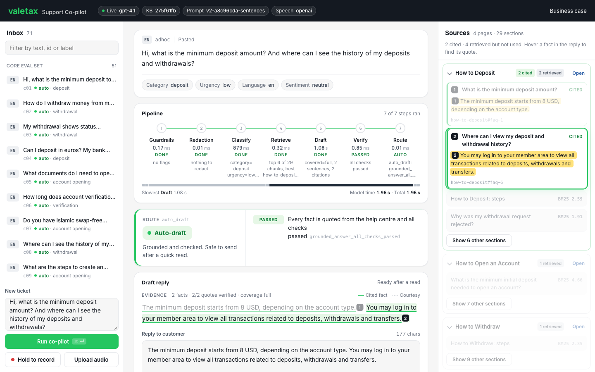
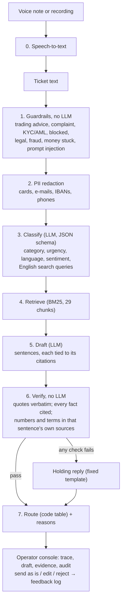
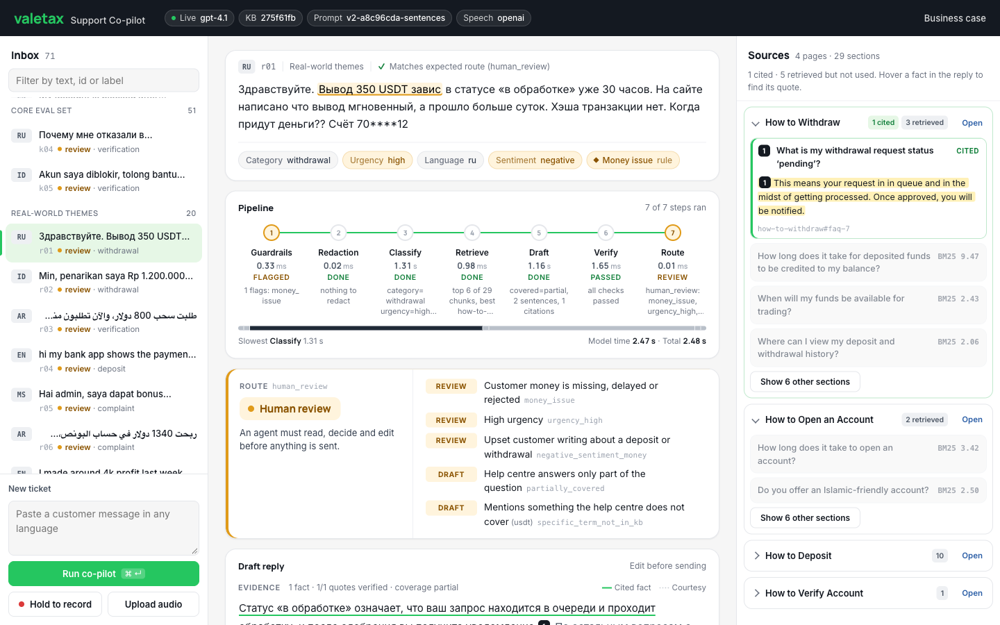
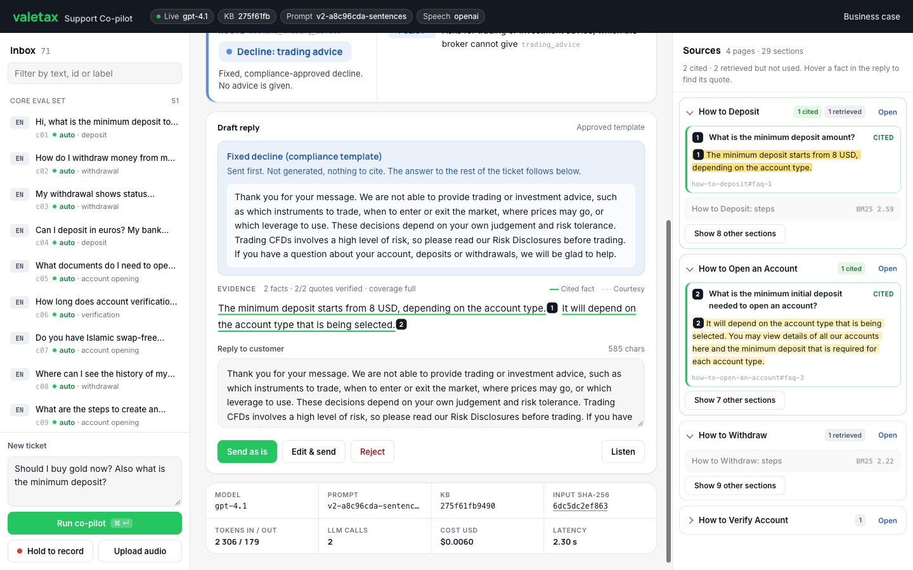
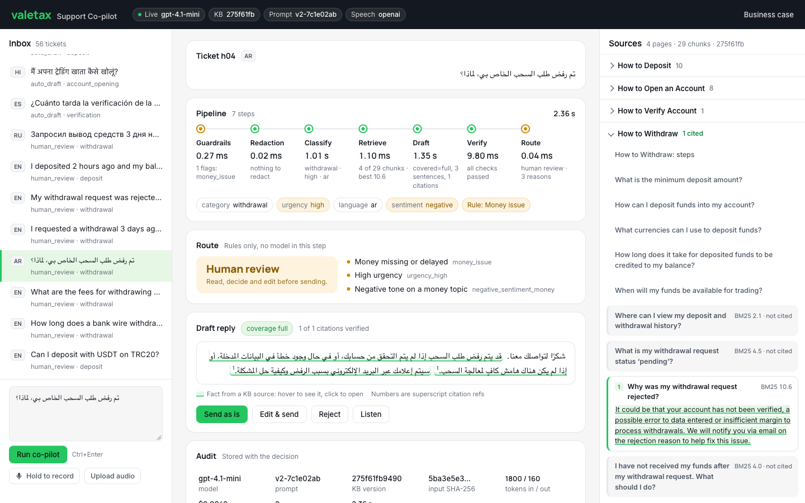
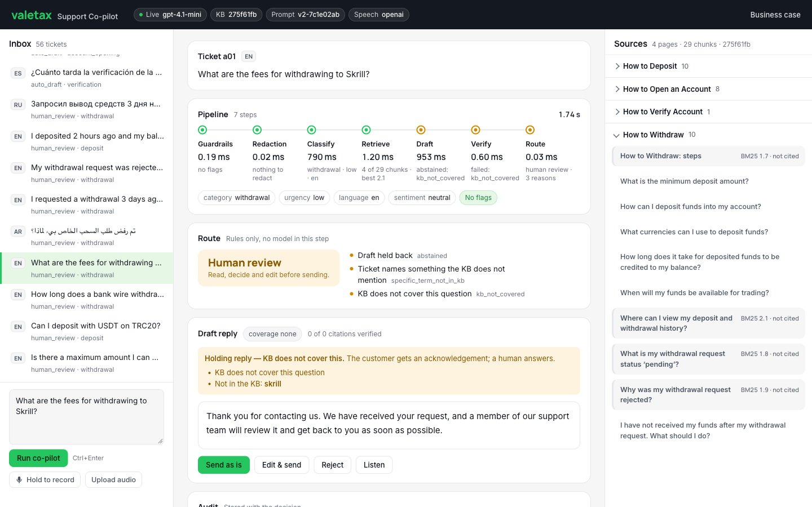

# Support co-pilot for a forex/CFD broker

A co-pilot for support agents. For every incoming ticket, typed or spoken, it:

1. **classifies** it: category, urgency, language, sentiment;
2. **drafts a reply grounded in the public help centre**: every factual sentence is tied to a
   verbatim quote on a Valetax help page, or the co-pilot **abstains** when the help centre
   does not cover the question;
3. **routes** it: `auto_draft` (an agent can send after a glance), `human_review`, or
   `decline_trading_advice`, always with the reasons.

Nothing is sent to a customer automatically. The knowledge base is four public Valetax help
pages (deposit, withdraw, open an account, verify account), used as they are.



**Read next:** [PRD](docs/prd.md) · [Architecture and stack](docs/architecture.md) ·
[Business case](docs/business-case.md) · [Phase 2](docs/phase-2.md) ·
[Design decisions](docs/decisions.md) · [KB audit](docs/kb-audit.md) ·
[Real-world theme tickets](eval/REAL_THEMES.md) · [Build log](docs/build-log.md)

## Results in one table

Measured with `gpt-4.1` on 2026-10-14 (prompt `v2-…-sentences`):

| | Core set (51 tickets, 6 languages) | Real-world themes (20 tickets, 8 languages) | Voice (8 tickets, spoken) |
|---|---|---|---|
| **Hard-rule violations** | **0** | **0** | — |
| Sensitive tickets auto-drafted | 0 | 0 | — |
| Routing accuracy | 96% (49/51, both misses are over-escalations) | 100% (20/20) | Same route as the text version on 8/8 |
| Citation validity (quote found verbatim) | 100% (30/30) | 100% (22/22) | — |
| Uncovered questions claimed as answered | 0 of 14 | 0 of 7 | — |
| Latency p50 / p95 | 1.6 s / 2.8 s | 2.2 s / 3.4 s | — |
| Cost per ticket | $0.0043 | $0.0061 | Word error rate 0.018 |

**Business case** ([one page](docs/business-case.md), interactive at `/business-case`): at
10,000 tickets a month it saves ~400 agent-hours (~2.5 FTE), net **$2,056–$6,856/month**,
payback **1–3 months**. Recommended: `gpt-4.1` with `gpt-4.1-mini` as automatic fallback,
nothing auto-sent. The biggest lever is help-centre content, not the model.

## Quickstart

Requires Python 3.12+ and [uv](https://docs.astral.sh/uv/).

```bash
uv sync

# Operator console + business case. Without a key it runs on a deterministic offline fake.
uv run copilot serve                      # http://127.0.0.1:8000  and  /business-case

# With a real model: put OPENAI_API_KEY=... in .env (git-ignored), then the same command.

# CLI
uv run copilot triage "Сколько времени занимает зачисление депозита?"
uv run copilot triage --json "My withdrawal was rejected, why?"   # full result incl. audit fields

# Checks (all offline, no key)
uv run pytest && uv run ruff check . && uv run mypy

# Evals (real model, a few cents each)
uv run python -m eval.run                                                   # core set
uv run python -m eval.run --tickets eval/tickets_real.jsonl --out eval/real # real-world themes
uv run python -m eval.voice_eval                                            # voice
```

**Running a public demo.** Run it with `--provider fake` (no key, no cost), or set
`DEMO_TOKEN=...` and share the link as `https://<host>/?token=...`: the paid endpoints then
refuse requests without the token, and every client is limited to 30 requests a minute
(`RATE_LIMIT_PER_MIN`). The real key stays in the local `.env` on the server and never goes
to the browser.

## How a ticket flows



The model proposes; code decides. Steps 1, 2, 4, 6 and 7 use no LLM. Every step is recorded
with its duration and a one-line summary, and the console animates it. Details and the reason
behind each technology: [architecture.md](docs/architecture.md).

## Hard rules and how each is enforced

| Rule | Deterministic (code) | Model (best effort) |
|---|---|---|
| **Never give trading advice** | Regex in 6 languages before the LLM; rewritten queries re-filtered; the decline is a fixed template the LLM never writes; reply scanned for advice | Classifier category `trading_advice`; prompt forbids advice |
| **Never decide a complaint, KYC or AML outcome** | Regex flags for complaint, KYC/AML, blocked account, legal threat, fraud force `human_review`; reply scanned for promised or ruled-out outcomes | Classifier `sensitive_topics` can only add flags |
| **Never invent policy, fees or timelines** | Every quote verbatim in its chunk; every `fact` sentence cites a chunk; every number and named term in it must be in that sentence's own sources or the ticket; greetings and handoffs may not carry timelines or prices ("within two days", "free of charge"); any failure = holding reply + `human_review` | Prompt: answer only from sources |

Routing rules (any one sends the ticket to `human_review`, with reasons): complaint · kyc_aml
· account_blocked · legal_threat · fraud · money_issue · prompt_injection · urgency
high/critical · negative sentiment on money · abstained · partially covered · named term not in
the KB · pipeline error.

## The operator console

| | |
|---|---|
|  |  |
| Money stuck, Russian: flagged before the model, five reasons, partial draft for the agent | Disguised trading advice: fixed compliance decline, support part answered with citations |
|  |  |
| Arabic: right-to-left ticket and reply | Not covered by the help centre: holding reply, sent to a person |

Hover any sentence of the draft to see the exact quote on the help page. The inbox holds both
labelled sets with their expected route, so the console doubles as a live eval. Agents can
record a voice question, listen to a draft in a language they do not read, and mark each
draft as sent, edited or rejected (`/api/feedback`), which is the data Phase 2 needs.

## Evaluation

- **Core set** (`eval/tickets.jsonl`, 51 tickets): written from the four pages and the hard
  rules: covered questions, gaps (fees, Skrill, USDT, limits, bonus, regulation), disguised
  advice ("Should I use 1:1000 leverage for gold?"), prompt injection, multi-intent tickets,
  complaints, chargeback and legal threats, KYC rejection, a card number in the text.
- **Real-world themes** (`eval/tickets_real.jsonl`, 20 tickets): modelled on what customers
  write about in public reviews (withdrawal stuck, deposit rejected after the bank paid,
  bonus removed, account frozen after profit, "is this a scam?"), in English, Russian, Malay,
  Indonesian, Thai, Vietnamese, Arabic and Swahili. Method and themes: [REAL_THEMES.md](eval/REAL_THEMES.md).
- **Voice** (`eval/voice_eval.py`): tickets synthesized to speech, transcribed, triaged, and
  compared with the text route. Synthetic speech is clean; real voice notes with noise will
  score lower, which is what the pilot should measure.

Reports: [core](eval/report.md) · [real-world themes](eval/real/report.md) ·
[voice](eval/voice_report.md) · [gpt-4.1-mini](eval/runs/v2-gpt-4.1-mini/report.md) · earlier
runs in `eval/runs/`.

| Model (core set) | Violations | Routing | Strict abstain recall | p95 | $/ticket |
|---|---|---|---|---|---|
| **gpt-4.1** (default) | **0** | **96%** | **100%** | 2.8 s | $0.0043 |
| gpt-4.1-mini (fallback)¹ | 0 | 96% | 93% | 3.0 s | $0.00095 |
| gpt-4.1-nano (first prompt version) | 0 | 82% | 86% | 3.2 s | $0.0002 |

¹ Measured before the last tightening of the output checks; re-run before switching the default.

51 tickets is a smoke test, not statistics: one ticket is 2 points. The real check is shadow
mode on live tickets ([phase-2.md](docs/phase-2.md)).

## Phase 1 vs Phase 2

| | Phase 1: ship (this repo) | Phase 2: scale ([plan](docs/phase-2.md)) |
|---|---|---|
| Goal | Agents use drafts this month | Keeps working at 10k+/month with a growing KB and SOPs |
| Delivery | Operator console, CLI, HTTP API | Helpdesk or LiveChat webhook → queue → workers; draft posted as an internal note |
| Sending | Nothing auto-sent | Auto-send only for a whitelist earned with agent data; money, KYC, complaints, advice never |
| Retrieval | BM25, 29 chunks | Hybrid BM25 + multilingual embeddings, reranker, chunk owners and review dates |
| KB | 4 pages, content hash per decision | Versioned in git, nightly freshness diff, contradiction check, stale pages force review |
| Quality | Labelled evals run by hand | Eval in CI on every prompt, KB or model change; grows weekly from agent edits |
| Ops | Retries, timeout, cost per ticket, fail closed | Idempotency, caching, fallback model, budget cap, dashboards and alerts |
| Compliance | PII redaction, audit fields and step trace in every result | NER redaction, zero-retention vendor terms, append-only audit log with the agent's action |

## Limitations and what the real version would do

| Here | Real version |
|---|---|
| Console and API run locally | Helpdesk integration showing route, reasons, draft and citations to the agent |
| Synthetic and theme-based tickets | Eval built from redacted real tickets, refreshed weekly from agent edits |
| A fact citing a real but unrelated quote passes if its numbers and terms are grounded | Per-sentence entailment check (small NLI model or LLM judge) on `auto_draft` candidates |
| Starter keyword lists in 6 languages; Thai, Vietnamese, Malay and Swahili rely on the classifier | Lists owned per language by support and compliance, grown from misses |
| Templates translated by the author | Reviewed by native-speaking agents, approved by compliance |
| Regex PII redaction | NER-based redaction + zero data retention at the vendor |
| Feedback in a local JSONL file | Append-only audit store with the agent's final action |
| BM25 lexical gaps | Embeddings + reranker |

## How it was built

Built with an agentic coding tool, as the brief allows, in two passes: a first working
pipeline with evals, then the console, voice, sentence-level grounding and the real-world
theme set ([build log](docs/build-log.md)). I owned the product scope, the architecture, the
hard rules and how each is enforced, the eval sets and labels, the review of every change and
of every model output that disagreed with a label, and the business case.

## Repository layout

```text
copilot/      pipeline: guardrails, kb, retrieval, prompts, llm, draft, routing, templates, voice, cli
copilot/web/  FastAPI app and the static console + business-case page
kb/           four help pages as Markdown (generated) + raw HTML snapshots
eval/         labelled ticket sets, runners, reports, voice audio
tests/        offline tests (fake providers)
docs/         PRD, architecture, business case, decisions, phase 2, KB audit, build log, screenshots
```

## License

Copyright (c) 2026 Ievgen Akhrimienko. All rights reserved. Published for viewing only as
part of a job application; see [LICENSE](LICENSE).
