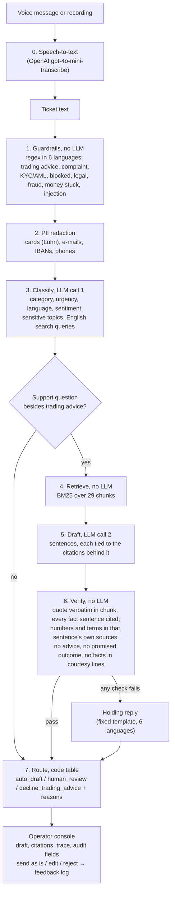

# Architecture and stack

How the co-pilot is built, where every input comes from, and why each technology was chosen.
Product requirements: [prd.md](prd.md). Design decisions in detail: [decisions.md](decisions.md).
Scaling plan: [phase-2.md](phase-2.md).

## 1. Where the data comes from

| Data | Source | How it gets into the repo | Where it lives |
|---|---|---|---|
| Knowledge base | Four public Valetax help pages: [How to deposit](https://valetax.com/how-to-deposit/), [How to withdraw](https://valetax.com/how-to-withdraw/), [How to open an account](https://valetax.com/how-to-open-an-account/), [How to verify account](https://valetax.com/how-to-verify-account/) | HTML saved on 2026-10-13, converted to Markdown by `copilot/kb_extract.py`; a test checks the Markdown was not edited by hand | `kb/raw/*.html` (snapshot), `kb/*.md` (generated) |
| KB chunks | The Markdown pages | One chunk per FAQ answer and one per page's "steps" section: 29 chunks, each with page URL and heading | Built in memory by `copilot/kb.py` |
| KB version | The chunk texts | SHA-256 of the KB content, stored in every result | `TriageResult.kb_version` |
| Core eval set | Written by hand from the four pages and the brief's hard rules | 51 labelled tickets in 6 languages: covered questions, gaps, disguised advice, injection, complaints, KYC, PII | `eval/tickets.jsonl` |
| Real-theme eval set | Themes from public review sites about Valetax (Trustpilot, WikiFX, broker reviews), paraphrased, no real names or quotes | 20 labelled tickets in 8 languages (en, ru, ms, id, th, vi, ar, sw) | `eval/tickets_real.jsonl`, sources and method in `eval/REAL_THEMES.md` |
| Voice eval set | A subset of the eval tickets, synthesized to speech | `eval/voice_eval.py` | `eval/audio/*.mp3`, `eval/voice_report.md` |
| Brand look of the console | valetax.com public stylesheet | Fonts and colours read from the site CSS (Inter, Manrope, `#25c660`, `#141921`) | `copilot/web/static/` |

The co-pilot answers **only** from the four pages, as the brief requires, with their gaps and
contradictions ([kb-audit.md](kb-audit.md)). Valetax's other public pages (payment methods,
account types) are deliberately not used, so questions about USDT fees or Malaysian bank
minimums are abstained on and sent to a person. That is the measured cost of a thin KB and the
first item for the content team.

## 2. One ticket, step by step



Each step is a plain function in its own module and is recorded in `TriageResult.trace` with
its duration and a one-line summary, which the console animates.

| Step | Module | LLM? | Why it is there |
|---|---|---|---|
| 0. Speech-to-text | `copilot/voice.py` | Speech model | Voice notes are common in the target markets; the transcript then takes the same path as text |
| 1. Guardrails | `copilot/guardrails.py` | No | Hard rules must not depend on the model; free, instant, immune to prompt injection |
| 2. PII redaction | `copilot/guardrails.py` | No | Customer data is removed before it reaches any vendor |
| 3. Classify | `copilot/pipeline.py`, `copilot/prompts.py` | Yes, JSON schema | Category, urgency, language, sentiment; rewrites questions as English queries so a Thai ticket can search an English KB |
| 4. Retrieve | `copilot/retrieval.py` | No | Deterministic, explainable search |
| 5. Draft | `copilot/draft.py`, `copilot/prompts.py` | Yes, JSON schema | Reply in the customer's language, sentence by sentence, each fact with its source |
| 6. Verify | `copilot/draft.py`, `copilot/guardrails.py` | No | The main defence against invented fees and timelines |
| 7. Route | `copilot/routing.py` | No | Who handles the ticket is a business rule, so it lives in code |

## 3. How hallucinations are controlled

Five layers. The first four are code; the fifth is a person.

1. **Closed book.** The draft model receives only the retrieved chunks and is told not to use
   anything else. If the best BM25 score is below a threshold, no draft is attempted.
2. **Verbatim quotes.** Every citation must be found character for character (after
   whitespace and quote normalisation) in the chunk it names. A paraphrased "quote" fails.
3. **Sentence-level grounding.** The model returns the reply as sentences of four kinds:
   `fact`, `greeting`, `closing`, `handoff`. Every `fact` must cite at least one valid
   citation. Every number and named term (fee, USDT, passport, Skrill, "24 hours") in a fact
   must appear in **that sentence's own** cited chunks or in the ticket. A courtesy sentence
   may not contain numbers, terms, timelines or cost words ("within two days", "free of
   charge", "instantly").
4. **Output scan.** The reply is scanned for trading advice and promised or ruled-out outcomes.
5. **A person in the loop.** Nothing is sent automatically. The console shows every sentence
   next to the exact quote it relies on, highlighted on the source page.

Any failure in 1–4 throws the draft away. The customer-facing text becomes a fixed holding
reply and the ticket goes to `human_review` with the reason. It fails closed: an LLM outage,
a schema error or a timeout gives the same safe result.

**Known limits.** A fact sentence can cite a real quote from a chunk that does not actually
support it, if its numbers and terms are grounded; there is no lexical-overlap check because
replies are multilingual and quotes are English. A number the customer wrote in the ticket
counts as grounded. Both are visible to the agent next to the quote, and both are candidates
for an entailment check (a small NLI model or an LLM judge) in Phase 2.

## 4. Stack and why

| Layer | Choice | Why this and not the alternative |
|---|---|---|
| Language | Python 3.12, `uv` | The brief prefers Python; `uv` gives a locked, reproducible environment in one command |
| LLM | OpenAI `gpt-4.1` (default), `gpt-4.1-mini` as fallback | Measured on the eval: 0 hard-rule violations, best abstention discipline; the LLM bill is ~1% of the saving, so quality wins over price ([business-case.md](business-case.md)) |
| Structured output | Pydantic models → JSON schema, temperature 0 | A malformed answer is an error, not a guess; the same models are the API contract |
| LLM integration | Two fixed calls, no agent framework | Same flow for every ticket: fixed cost and latency, each step testable alone. An agent loop adds non-determinism without a need |
| Vendor isolation | `LLMProvider` and `SpeechProvider` protocols, OpenAI and fake implementations | Swap vendor or add a fallback in one file; tests run offline |
| Retrieval | Own BM25 (~100 lines) with Snowball stemming | 29 chunks do not need a vector database; BM25 is deterministic and explains its scores. Phase 2: hybrid with multilingual embeddings and a reranker behind the same `search()` |
| Speech | `gpt-4o-mini-transcribe`, `gpt-4o-mini-tts` | Handles the markets' languages (ms, id, th, vi, sw, ar) at cents per hour |
| Web | FastAPI + Uvicorn | Typed request models, automatic validation, threadpool for blocking calls |
| Front end | One HTML page, vanilla JS, GSAP from a CDN | No build step, nothing to install; GSAP only to make the pipeline readable as it runs |
| Business case page | Self-contained HTML with the formula from `business-case.md` | Management can change the assumptions and see the verdict move |
| Quality | pytest, ruff, mypy `--strict`, GitHub Actions | All offline with fake providers; no key in CI |

## 5. Code map

```text
copilot/
  guardrails.py   regex detectors (6 languages), PII redaction, output scan, named terms
  pipeline.py     Copilot.triage: runs the 7 steps, fills the trace and audit fields
  prompts.py      classification and draft prompts, prompt version hash
  retrieval.py    BM25 index
  kb.py           Markdown pages -> chunks, KB version hash
  kb_extract.py   saved HTML -> Markdown
  draft.py        grounded draft and every verification check
  routing.py      routing table: route + reasons
  templates.py    fixed decline and holding replies, 6 languages
  llm.py          LLMProvider, OpenAI provider (retries, timeout, cost), fake provider
  voice.py        SpeechProvider, OpenAI speech, fake speech
  models.py       Pydantic contracts for every step boundary
  cli.py          `copilot triage`, `copilot serve`
  web/app.py      FastAPI: triage, voice, tts, kb, samples, feedback
  web/static/     operator console, business-case page
eval/             labelled tickets, runner, reports, voice eval
tests/            offline tests for every module
kb/               the four help pages: raw HTML and generated Markdown
docs/             PRD, architecture, business case, decisions, phase 2, KB audit, build log
```

## 6. Web API

| Endpoint | Purpose |
|---|---|
| `GET /` | Operator console |
| `GET /business-case` | One-page business case |
| `GET /api/health` | Provider, model, speech provider, KB version, prompt version |
| `GET /api/samples` | Labelled sample tickets for the inbox |
| `GET /api/kb` | KB pages and chunks, for highlighting citations |
| `POST /api/triage` | Text ticket → full `TriageResult` with trace |
| `POST /api/voice` | Audio file (≤ 10 MB, checked before parsing) → transcript + `TriageResult` |
| `POST /api/tts` | Draft text → MP3, so an agent can listen to a reply in a language they do not read |
| `POST /api/feedback` | Agent action: sent as is / edited / rejected, appended to `data/feedback.jsonl` |
| `GET /api/feedback/stats` | Counts of agent actions |

Blocking model calls run in FastAPI's threadpool. Vendor error texts are logged on the server
and never returned to the browser.

## 7. Audit record

Every result carries what a regulator or a team lead needs to answer "why did the customer get
this reply?": input SHA-256 (not the text), guardrail flags, classification, retrieved chunk ids
and scores, draft sentences with their citations, route and reasons, model, prompt version,
KB version, tokens, cost, latency and the step trace. Phase 2 stores it in an append-only log
together with the agent's action and final text.
