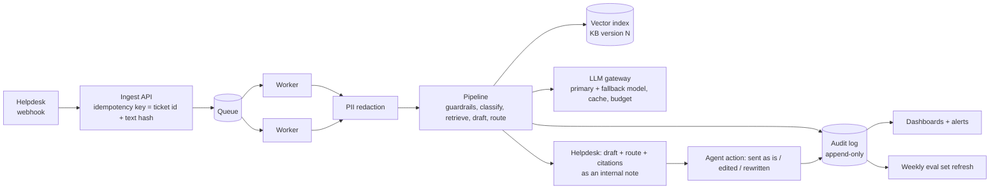

# Phase 2: scaling up

Phase 1 is a library + CLI that an agent (or a helpdesk macro) calls per ticket. Phase 2
keeps the same pipeline and the same rules, and changes what is around it so it keeps
working when volume grows past ~10,000 tickets/month and the KB and SOPs grow from 4 pages to
hundreds.

What does **not** change: deterministic guardrails first, routing as a code table,
citations checked by code, fail closed, and nothing reaches a customer that a check did not
pass.

## 1. Architecture

| Concern | Phase 1 | Phase 2 |
|---|---|---|
| Intake | CLI / function call | Helpdesk webhook -> queue -> stateless workers |
| Throughput | 1 ticket in ~2-4 s | 10k/month is ~14 tickets/hour on average, peaks of maybe 10x. Two workers are enough; the queue absorbs spikes and LLM rate limits |
| Idempotency | none | key = ticket id + SHA-256 of text; a retried webhook returns the stored result instead of a second LLM call |
| Retries | SDK retries (3) + timeout | Same, plus dead-letter queue: after N failures the ticket gets the holding reply and `human_review` (already the fail-closed path) |
| Caching | none | Cache classification and draft by (text hash, model, prompt version, KB version). Any version change is a cache miss by construction |
| LLM vendor | one provider | LLM gateway: primary model, fallback model on outage, per-day budget cap, request logging. The `LLMProvider` interface already isolates this |

## 2. Retrieval for a large KB

BM25 over 29 chunks is fine today. With hundreds of pages and SOPs:

- **Embeddings + hybrid search.** Multilingual embedding model, stored in pgvector (one
  Postgres is easier to run than a separate vector DB at this size). Keep BM25 and merge both
  result lists (reciprocal rank fusion): BM25 still wins on exact terms like "TRC20" or an
  error code.
- **Reranker** (cross-encoder) on the top ~20, keep top 5. Its score is a better "is this
  relevant?" signal than raw BM25, so the low-retrieval threshold becomes meaningful.
- **Query rewriting stays**: the classifier already writes one English query per question.
- **Chunk metadata**: page, section, owner, `valid_from`, `review_by`, audience (public KB vs
  internal SOP). Internal SOPs can guide the agent's draft notes but must never be quoted to a
  customer; a `public` flag on the chunk enforces this in code.

## 3. KB and SOP versioning and freshness

- The KB lives in git (Markdown generated from the CMS, as `kb_extract.py` does now). Every
  merge creates a KB version; the version hash is already stored with every decision.
- **Freshness check** (nightly): re-download the public pages, re-extract, diff. A changed
  page opens a pull request; the eval runs on it (next section) before the new KB goes live.
- Each page has an owner and a `review_by` date. Expired pages are still served, but drafts
  citing them go to `human_review` with reason `stale_source`.
- Contradiction check: when two chunks give different numbers for the same thing (for
  example "instant" vs "within 60 minutes", docs/kb-audit.md), the PR is flagged for the owner.

## 4. Evaluation in CI

- `eval/tickets.jsonl` becomes a versioned dataset, grown every week from real tickets
  (redacted) where agents disagreed with the co-pilot.
- On every change to a prompt, model, guardrail list or the KB, CI runs the eval against the
  real model and **blocks the merge** if: hard-rule violations > 0, sensitive tickets
  auto-drafted > 0, or routing accuracy / citation validity drop more than an agreed margin.
- Offline tests (fake provider) still run on every commit; the paid eval runs on PRs that
  touch prompts, KB, guardrails or model config.
- Run each paid eval twice: at temperature 0 the outputs still vary a little between runs
  (visible in Phase 1: see `eval/runs/*-repeat`).

## 5. Monitoring

Dashboards and alerts on the audit log, per day and per language/category:

| Signal | Why | Alert when |
|---|---|---|
| Route mix (auto_draft / human_review / decline) | Detects drift in tickets or model | auto_draft share moves > 10 pp week over week |
| Abstain rate per category | KB gaps; tells the content team what to write next | rises after a KB change |
| Citation-check and number-check failures | Model or prompt regression | any day above baseline |
| Hard-rule signals: advice or outcome promise caught by `scan_reply`, agent marks "unsafe draft" | Compliance | any |
| Agent edit distance (sent as is / light edit / rewrite) | The real quality metric | rewrite share rises |
| Cost per ticket, tokens, latency p95, LLM error rate | Budget and reliability | budget 80% / p95 > 10 s / errors > 1% |

## 6. Human feedback loop

- In the helpdesk the agent sees the draft, route, reasons and citations, and either sends as
  is, edits, or rewrites. The final text and the action are stored next to the draft.
- Weekly review of: rewrites, `human_review` tickets the agent sent unchanged (over-escalation),
  and any unsafe draft. Each finding becomes either an eval ticket, a guardrail keyword, a KB
  fix, or a prompt change, and goes through the CI eval above.
- **Graduated automation.** Only after several weeks of data: allow auto-send for a narrow
  whitelist (e.g. `auto_draft` + category in {deposit, account_opening} + coverage `full` +
  agent sent-as-is rate > 95% for that FAQ chunk over the last month). Everything else stays a
  draft. Money, KYC, complaints and trading advice never auto-send.

## 7. Multilingual

- Classification and drafting already work in the customer's language; retrieval works
  through English queries. Phase 2 adds a multilingual embedding model so queries in any
  language also match directly.
- Fixed templates (holding reply, trading-advice decline) are reviewed by native-speaking
  agents and compliance for each supported language; unknown languages fall back to English
  and are flagged.
- Guardrail keyword lists get an owner per language and are grown from missed cases.

## 8. Privacy, compliance and audit

- **PII redaction before the LLM** (Phase 1 already redacts cards, e-mails, IBANs and phone
  numbers). Phase 2 adds names, addresses and document numbers with an NER model, and a data
  processing agreement with zero data retention at the LLM vendor (or a self-hosted model for
  the most sensitive queues).
- **Audit log, append-only**, one row per decision: ticket id, input SHA-256 (not the text),
  guardrail flags, classification, retrieved chunk ids and KB version, model and prompt
  version, draft, citations, route and reasons, latency and cost, then the agent's action,
  final text and agent id. This answers the regulator's question "why did the customer get
  this reply, and who approved it?" for any ticket. Phase 1 already returns every field except
  the agent's action (`TriageResult`).
- Retention period and access control per the broker's data policy; the audit log is
  write-once for the application.
- The trading-advice decline text and holding replies are versioned like code and approved
  by compliance.

## 9. Rollout

1. Shadow mode (1-2 weeks): the co-pilot runs on live tickets, agents do not see it; compare
   its route with what agents did. Gate: zero unsafe drafts on the sample, routing agreement
   above the eval number.
2. Assist mode: drafts visible to a pilot group of agents, one language first.
3. All agents, all languages with reviewed templates.
4. Graduated auto-send for the whitelist above, if the data supports it.
